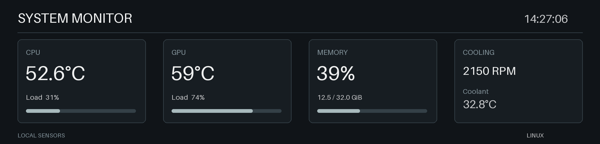

# COUGAR CFV235 Vision on Linux

An unofficial Linux dashboard for the [COUGAR CFV235 Vision](https://cougargaming.com/us/products/cases/cfv235-vision/) 1920 × 462 USB LCD. It renders CPU, GPU, memory and cooling readings as a PNG and can send that PNG as a background to the panel over Linux hidraw. A preview can run without a connected display.



*Software preview rendered with sample readings. The hardware status below describes what has been observed on a physical LCD.*

## Hardware status

| Feature | Evidence |
| --- | --- |
| Display a Linux-generated background on the LCD | Observed in an earlier Ubuntu test documented on 20 October 2026. |
| Detect USB HID device `1d6b:0126` | The ID and device name were recorded during earlier development. Detection with this package still needs a hardware check. |
| Refresh the clock and sensor readings on the LCD | Implemented by sending successive backgrounds. Visible refreshes with this package still need a hardware check. |
| Resume and brightness | Commands are included in the recovered startup sequence. The physical response and persistence still need checking. |
| Local dashboard rendering | Tested offline with sample readings and with unavailable sensors. |

A USB acknowledgment means the controller accepted a report. Check the picture, changing clock and brightness on the panel itself.

## Install

Use Linux with hidraw, Python 3.10 or later and a user account with read/write access to the LCD. From the root of a local checkout on Debian or Ubuntu:

```sh
sudo apt install python3-venv fonts-dejavu-core lm-sensors
python3 -m venv .venv
.venv/bin/python -m pip install .
```

On other distributions, install the equivalent Python and sensor packages. Pillow is installed by pip. Fonts and `lm-sensors` are optional. The dashboard can also read the first GPU reported by `nvidia-smi` when it is available.

## USB permissions

Run `.venv/bin/cougar-cfv235 --detect` to identify the matching `/dev/hidrawN` device. If a later send fails with a permissions error, users in a local desktop session on a systemd-based distribution can install the included udev rule:

```sh
sudo install -m 0644 docs/70-cougar-cfv235.rules /etc/udev/rules.d/
sudo udevadm control --reload-rules
```

Reconnect the LCD to apply the rule during a safe maintenance window. The rule uses `uaccess` to grant access to the active local seat. On headless systems, an administrator can use a dedicated local group and a device-specific udev rule. The application uses the device name as well as the USB ID because the ID alone may match other devices.

## Run

```sh
# Render sample data without an LCD
.venv/bin/cougar-cfv235 --demo --preview demo.png

# Render local sensor data without touching USB
.venv/bin/cougar-cfv235 --preview live-preview.png

# Send a single live dashboard frame
.venv/bin/cougar-cfv235 --send --seconds 0

# Refresh for 20 seconds after the first frame, at 70% brightness
.venv/bin/cougar-cfv235 --send --seconds 20 --interval 2 --brightness 70
```

Ensure Linux owns the USB device before sending. If the LCD is passed through to a VM, close its LCD application and release the USB device on the guest side first. Run one LCD controller at a time. Press Ctrl+C to stop. Sending changes the displayed background and sets the selected brightness (100 by default). The program does not restore the previous screen contents. The refresh window starts after the first frame, and an in-flight USB transfer may run past the window.

## Known limitations

- The target is the CFV235 Vision USB panel with the observed controller ID and name. Other revisions, the standalone LCD kit and the Mesh Vision have no compatibility results here.
- Missing readings display as `--`. CPU and memory usage come from Linux `/proc`. CPU temperature uses supported `lm-sensors` labels for AMD and Intel. Pump speed and coolant temperature require compatible `kraken2` readings. GPU readings use the first NVIDIA GPU exposed by `nvidia-smi`.
- The first release uses full background frames for updates. Overlay-only updates, video, animations, official themes, firmware operations and startup services are outside its scope.
- The refresh interval is a pause between updates. Reading sensors, rendering and transferring images adds time, so this is not a 60 fps video output.
- The firmware behavior after closing the application, reconnecting USB or resuming the host still needs hardware confirmation.

Run offline tests with `.venv/bin/python -m unittest discover -s tests -v`. See [the hardware test procedure](docs/hardware-test.md) to record results for a specific release.

## License

The project's original code and documentation are available under the [MIT License](LICENSE). Pillow is installed separately under its own license. COUGAR and its product names identify the supported hardware. This is an independent project.
